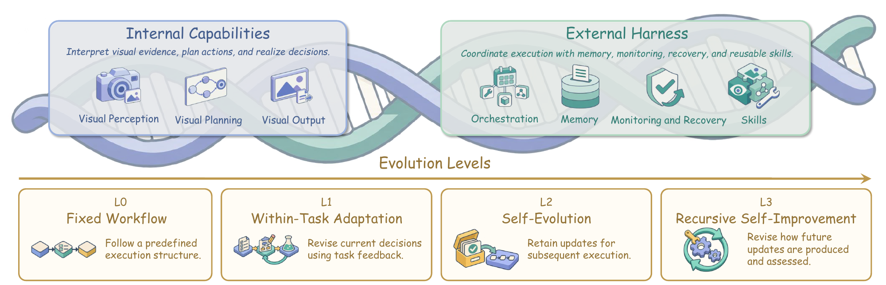
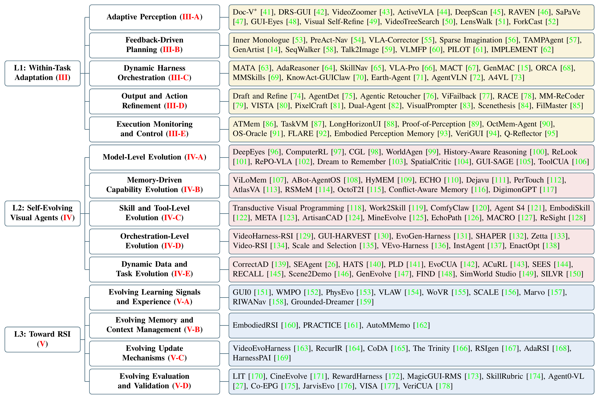
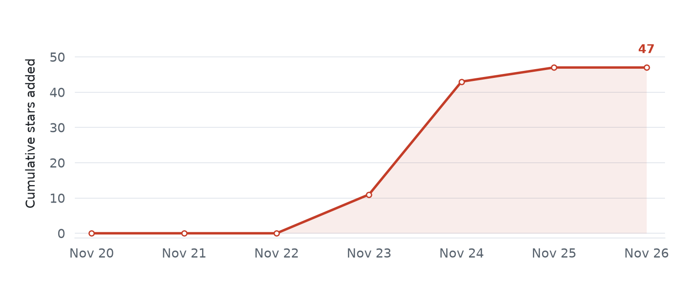

<h1 align="center">🔍 Visual Agents in the Era of Self-Evolution:<br>Toward Recursive Self-Improvement</h1>

<p align="center">
  <a href="https://github.com/CaDmium2003"><strong>Dong Chen</strong></a> &middot;
  <a href="https://github.com/sleepy-shawn"><strong>Shuai Ge</strong></a> &middot;
  <a href="https://github.com/xiaoyu2029"><strong>Yu Fu</strong></a> &middot;
  <a href="https://github.com/A1ucardR"><strong>Xiangyu Ren</strong></a> &middot;
  <a href="https://github.com/imwoodz123"><strong>Zhihao Zhang</strong></a> &middot;
  <a href="https://haowangzju.github.io/"><strong>Hao Wang</strong></a> &middot;
  <a href="https://changshuowang.github.io/"><strong>Changshuo Wang</strong></a> &middot;
  <a href="https://iai.xmu.edu.cn/info/2981/5885.htm"><strong>Jiayi Ji</strong></a> &middot;
  <a href="https://henghuiding.github.io/"><strong>Henghui Ding</strong></a> &middot;
  <a href="https://heshuting555.github.io/"><strong>Shuting He</strong></a>
</p>

<p align="center">
  <a href="#arxiv-paper"></a>
  <a href="https://visual-agent-survey.github.io/"></a>
  <a href="#table-of-contents"></a>
</p>

<p align="center">
  <a href="#table-of-contents">📚 Contents</a> &nbsp;·&nbsp;
  <a href="#taxonomy">🗺️ Taxonomy</a> &nbsp;·&nbsp;
  <a href="#benchmarks-and-datasets">📊 Benchmarks</a> &nbsp;·&nbsp;
  <a href="#l1-within-task-adaptation">🧭 Adaptation &amp; Evolution</a> &nbsp;·&nbsp;
  <a href="#star-history">⭐ Star History</a> &nbsp;·&nbsp;
  <a href="#citation">📢 Citation</a>
</p>

<p align="center">
  
</p>

<a name="introduction"></a>

## ✨ Introduction

💡 This repository accompanies a survey of visual agents that use images, video, and interactive feedback to guide their decisions. The survey covers visual understanding, image and video generation and editing, computer use, and embodied interaction.

We view a visual agent as one or more models operating within a harness that coordinates tools, memory, and execution. The survey follows three levels of experience-driven change, from adapting within a task to retaining updates across tasks and revising how future updates are produced.

<a name="table-of-contents"></a>
<a name="contents"></a>

## 📚 Contents

| Section | Topics |
| --- | --- |
| [**🗺️ Taxonomy**](#taxonomy) | Visual map of L1–L3 and representative methods |
| [**📊 Benchmarks and Datasets**](#benchmarks-and-datasets) | [Task-level](#task-level-evaluation) · [Self-evolution](#self-evolution-evaluation) · [Recursive self-improvement](#recursive-self-improvement-evaluation) |
| [**🟡 L1 · Within-Task Adaptation**](#l1-within-task-adaptation) | [Perception](#adaptive-perception) · [Planning](#feedback-driven-planning) · [Orchestration](#dynamic-harness-orchestration) · [Refinement](#output-and-action-refinement) · [Monitoring](#execution-monitoring-and-control) |
| [**🔴 L2 · Self-Evolving Visual Agents**](#l2-self-evolving-visual-agents) | [Models](#model-level-evolution) · [Memory](#memory-driven-capability-evolution) · [Skills and tools](#skill-and-tool-level-evolution) · [Orchestration](#orchestration-level-evolution) · [Data and tasks](#dynamic-data-and-task-evolution) |
| [**🔵 L3 · Toward Recursive Self-Improvement**](#l3-toward-recursive-self-improvement) | [Learning signals](#evolving-learning-signals-and-experience) · [Memory and context](#evolving-memory-and-context-management) · [Updates](#evolving-update-mechanisms) · [Evaluation](#evolving-evaluation-and-validation) |
| [**📖 Related Surveys**](#related-surveys) | Multimodal agents, visual generation, computer use, and physical AI |

<a name="taxonomy"></a>

## 🗺️ Taxonomy

The taxonomy maps the L1–L3 mechanisms to representative papers. Select the figure to view it at full resolution.

<p align="center">
  <a href="figs/visual-agent-taxonomy.png"></a>
</p>

<a name="benchmarks-and-datasets"></a>

## 📊 Benchmarks and Datasets

Expand a topic to browse its entries. Benchmark names link to the paper or official documentation. Scale refers to the version or subset covered in the survey, and an asterisk marks a partial code or data release.

<a name="task-level-evaluation"></a>

<details>
<summary><strong>🎯 Task-Level Evaluation</strong> (40)</summary>

These benchmarks test active perception, planning and tool use, output revision, and monitoring during a task.

| 📋 Benchmark | 📅 Venue / Year | Setting | 🎯 Evaluation focus | Scale | 🔗 Code / Data |
| --- | --- | --- | --- | --- | --- |
| [ActiView](https://aclanthology.org/2025.acl-long.376/) | ACL 2025 | Image Interaction | Shifting / Zooming | 325 Distinct Questions | [Code](https://github.com/THUNLP-MT/ActiView) · [Data](https://huggingface.co/datasets/wangphoebe/ActiView) |
| [AgentVQA](https://arxiv.org/abs/2610.31494) | arXiv 2026 | Offline | Agent-State Understanding | 1,000 Examples | [Code](https://github.com/zlab-princeton/AgentVQA) · [Data](https://huggingface.co/datasets/AgentVQA/AgentVQA) |
| [Video-MME-v2](https://arxiv.org/abs/2604.05015) | arXiv 2026 | Offline | Temporal Consistency | 3,200 QA Pairs | [Code](https://github.com/MME-Benchmarks/Video-MME-v2) · [Data](https://huggingface.co/datasets/MME-Benchmarks/Video-MME-v2) |
| [ENACT](https://arxiv.org/abs/2511.20937) | ICLR 2026 | Offline | State–Action Reasoning | 8,972 QA Pairs | [Code](https://github.com/mll-lab-nu/ENACT) · [Data](https://huggingface.co/datasets/MLL-Lab/ENACT) |
| [MPR-GUI-Bench](https://aclanthology.org/2026.acl-long.1375/) | ACL 2026 | Offline | Multilingual GUI Reasoning | 12,936 Samples | [Data](https://huggingface.co/datasets/chenruihan/MPR-GUI-Bench) |
| [ActiveArena-Bench](https://arxiv.org/abs/2609.24124v2) | arXiv 2026 | Simulation | Active Visual Evidence | 35 Tasks | [Code](https://github.com/leeibo/ActiveArena) · [Data&#42;](https://github.com/leeibo/ActiveArena/blob/main/task_config/eval_seed_task_whitelist.yml) |
| [OpenEQA (Active)](https://openaccess.thecvf.com/content/CVPR2024/html/Majumdar_OpenEQA_Embodied_Question_Answering_in_the_Era_of_Foundation_Models_CVPR_2024_paper.html) | CVPR 2024 | Simulation | Exploration for Visual QA | 557 HM3D Questions | [Code&#42;](https://github.com/facebookresearch/open-eqa) · [Data](https://github.com/facebookresearch/open-eqa/blob/main/data/README.md) |
| [OSWorld 2.0](https://arxiv.org/abs/2606.29537) | arXiv 2026 | Interactive GUI | Long-Horizon Execution | 108 Workflows | [Code](https://github.com/xlang-ai/OSWorld-V2/tree/v2026.06.24) · [Data](https://huggingface.co/datasets/xlangai/osworld_v2_tasks) |
| [WebArena-Pro](https://arxiv.org/abs/2611.17955) | NeurIPS 2026 | Interactive GUI | Multimodal Web Tasks | 300 Test Tasks | [Code](https://github.com/McGill-NLP/webarena-pro) · [Data](https://huggingface.co/datasets/WebArena-Pro/WebArena-Pro) |
| [Ego2Web](https://arxiv.org/abs/2603.22529) | CVPR 2026 | Interactive GUI | Egocentric Web Tasks | 500 Video-Task Pairs | [Code](https://github.com/Yui010206/Ego2Web) · [Data](https://huggingface.co/datasets/Shoubin/Ego2Web) |
| [NaturalGAIA](https://aclanthology.org/2026.acl-long.2207/) | ACL 2026 | Interactive GUI | User-Intent Satisfaction | 276 Tasks | [Code](https://github.com/KeLes-Coding/LightManus_Jarvis) · [Data&#42;](https://github.com/KeLes-Coding/LightManus_Jarvis/tree/main/task) |
| [ProSoftArena](https://arxiv.org/abs/2601.02399) | CVPR 2026 | Interactive GUI | Professional Software | 436 Tasks | — |
| [SuperAPP Benchmark](https://aclanthology.org/2026.acl-long.2052/) | ACL 2026 | Interactive GUI | Super-App Task Execution | 230 Tasks | — |
| [VisualWebArena](https://aclanthology.org/2024.acl-long.50/) | ACL 2024 | Interactive GUI | Visually Grounded Web Tasks | 910 Tasks | [Code](https://github.com/web-arena-x/visualwebarena) · [Data](https://github.com/web-arena-x/visualwebarena/tree/main/config_files) |
| [MemU-Bench](https://arxiv.org/abs/2611.00191) | arXiv 2026 | Mobile GUI | Execution from User History | 118 GUI Tasks | [Code](https://github.com/ZJU-REAL/MemU-Bench) · [Data](https://huggingface.co/datasets/vagrt/MemU-Bench-data) |
| [AsgardBench](https://arxiv.org/abs/2603.15888v2) | arXiv 2026 | Simulation | Visual Plan Adaptation | 108 Task Instances | [Code](https://github.com/microsoft/AsgardBench) · [Data](https://github.com/microsoft/AsgardBench/tree/main/Generated) |
| [DeepPHY](https://arxiv.org/abs/2508.05405) | AAAI 2026 | Simulation | Physical Planning / Action | 6 Envs. | [Code](https://github.com/XinrunXu/DeepPHY) · [Data&#42;](https://github.com/XinrunXu/DeepPHY/tree/main/res) |
| [EmbodiedWorldBench](https://arxiv.org/abs/2607.10350v3) | arXiv 2026 | Simulation | Dynamic Embodied Planning | &gt;200 Tasks | — |
| [PokéAgent (Speedrunning)](https://arxiv.org/abs/2603.15563v2) | NeurIPS 2026 | Simulation | Long-Horizon RPG Planning | 15 Milestones | [Starter kit](https://github.com/sethkarten/pokeagent-speedrun) |
| [ALFRED](https://arxiv.org/abs/1912.01734) | CVPR 2020 | Simulation | Household Goal Completion | 8,055 Expert Demos | [Code](https://github.com/askforalfred/alfred) · [Data](https://github.com/askforalfred/alfred/blob/master/data/README.md) |
| [OSWorld-MCP](https://arxiv.org/abs/2510.24563) | ICLR 2026 | Interactive GUI | Tool Invocation / Outcomes | 361 Evaluated Tasks | [Code](https://github.com/X-PLUG/OSWorld-MCP) · [Data](https://github.com/X-PLUG/OSWorld-MCP/tree/main/evaluation_examples) |
| [AgentVista](https://arxiv.org/abs/2602.23166) | NeurIPS 2026 | Tool Environment | Long Tool Workflows | 209 Tasks | [Code](https://github.com/hkust-nlp/AgentVista) · [Data](https://huggingface.co/datasets/Warrieryes/AgentVista) |
| [EgoBench](https://arxiv.org/abs/2605.27820v2) | NeurIPS 2026 | Tool Environment | Video / Tool / User Goals | 1,590 Tasks | [Code](https://github.com/Wind-Flipped/EgoBench) · [Data](https://huggingface.co/datasets/emodiary/EgoBench) |
| [3DCodeBench](https://arxiv.org/abs/2606.01057) | NeurIPS 2026 | 3D Modeling | 3D Code Refinement | 212 Object Categories | [Code](https://github.com/gaoypeng/3dcodebench) · [Data](https://huggingface.co/datasets/YipengGao/3DCodeBench) |
| [3DHarnessBench](https://arxiv.org/abs/2609.06535) | arXiv 2026 | 3D Modeling | View / Geometry Access | 100 Objects | [Code](https://github.com/llada60/3DHarnessBench) · [Data](https://huggingface.co/datasets/lingada/3DHarnessBench) |
| [PPT-Eval](https://arxiv.org/abs/2606.31154) | ICML 2026 | Interactive GUI | Slide Creation / Editing | 120 Tasks | [Code](https://github.com/microsoft/ppteval) · [Data](https://github.com/microsoft/ppteval/tree/main/task_registry) |
| [WeGenEditBench](https://arxiv.org/abs/2610.41210) | arXiv 2026 | Offline | Editing Constraint Checks | 2,740 Eval. Instances | — |
| [RefCraft](https://arxiv.org/abs/2610.26826v2) | arXiv 2026 | Tool Environment | Reference-Guided Webpages | 300 Tasks | [Code](https://github.com/wangyuchi369/RefCraft) · [Data](https://huggingface.co/datasets/YuchiWang/RefCraft) |
| [GenEvolve-Bench](https://arxiv.org/abs/2605.21605) | NeurIPS 2026 | Tool Environment | Tool-Assisted Generation | 594 Held-Out Prompts | [Code](https://github.com/MeiGen-AI/GenEvolve) · [Data](https://huggingface.co/datasets/MeiGen-AI/GenEvolve-Data-Bench) |
| [ComfyBench](https://arxiv.org/abs/2409.01392) | CVPR 2025 | Tool Environment | Visual Workflow Outputs | 200 Tasks | [Code](https://github.com/xxyQwQ/ComfyBench) · [Data](https://github.com/xxyQwQ/ComfyBench/tree/main/dataset/benchmark) |
| [VAB-CSS](https://proceedings.iclr.cc/paper_files/paper/2025/hash/eea71dc576381b88f2a0ca4dedc2140d-Abstract-Conference.html) | ICLR 2025 | Tool Environment | Target Screenshot Match | 165 Test Cases | [Code](https://github.com/THUDM/VisualAgentBench) |
| [VPI-Bench](https://arxiv.org/abs/2506.02456) | ICLR 2026 | Interactive GUI | Visual Prompt Injection | 306 Test Cases | [Code](https://github.com/cua-framework/agents) · [Data](https://huggingface.co/datasets/VPI-Bench/vpi-bench) |
| [CUA-Recovery](https://arxiv.org/abs/2610.27645) | arXiv 2026 | Interactive GUI | Inherited-Error Recovery | 2,250 Error States | [Code](https://github.com/xu-hu-2002/CUA-Recovery) |
| [ProBench](https://arxiv.org/abs/2511.09157) | AAAI 2026 | Mobile GUI | Process-Sensitive Outcomes | &gt;200 Tasks | — |
| [FailBench](https://arxiv.org/abs/2609.03611) | arXiv 2026 | Offline | Robot Task-Success Judging | 2,197 Attempts | — |
| [SAFE-VERSE](https://arxiv.org/abs/2506.14697) | CVPR 2026 | Simulation | Safe Execution | 1,350 Hazardous Tasks | — |
| [IS-Bench](https://arxiv.org/abs/2506.16402) | AAAI 2026 | Simulation | Safe Action Ordering | 161 Eval. Scenarios | [Code](https://github.com/AI45Lab/IS-Bench) · [Data](https://huggingface.co/datasets/Ursulalala/IS_Bench_dataset) |
| [RecoverBench](https://neurips.cc/virtual/2026/poster/139223) | NeurIPS 2026 | Simulation | Manipulation Recovery | 1,360 Error Scenes | [Code](https://github.com/ErrorRecoveryBenchmark/ErrorRecoveryBenchmark) · [Data](https://huggingface.co/datasets/ErrorRecovery/ErrorRecoveryBenchmark) |
| [FRBench-Sim](https://arxiv.org/abs/2605.09410) | NeurIPS 2026 | Simulation | Post-Failure Recovery | 10 Evaluated Tasks | [Code](https://github.com/1018weijia/FR_Bench) |
| [Safety-CHORES](https://proceedings.neurips.cc/paper_files/paper/2025/hash/e185c7be603426028c32ae1003a59d78-Abstract-Conference.html) | NeurIPS 2025 | Simulation | Cumulative Safety Cost | 3 Task Families | [Code](https://github.com/PKU-Alignment/SafeVLA) · [Data](https://github.com/PKU-Alignment/SafeVLA#21-downloading-assets-annotations-and-houses) |

</details>

<a name="self-evolution-evaluation"></a>

<details>
<summary><strong>📈 Self-Evolution Evaluation</strong> (20)</summary>

These protocols track what agents learn, retain, and transfer across tasks or sessions.

| 📋 Benchmark | 📅 Venue / Year | Setting | 🎯 Evaluation focus | Scale | 🔗 Code / Data |
| --- | --- | --- | --- | --- | --- |
| [Continual Manipulation](https://arxiv.org/abs/2605.26820v3) | arXiv 2026 | Physical Robot | Acquisition / Retention | 10 Robot Tasks | [Code](https://github.com/Agentic-Intelligence-Lab/ContinualVLA) · [Data&#42;](https://github.com/Agentic-Intelligence-Lab/ContinualVLA#dataset) |
| [World-Model CL Benchmark](https://arxiv.org/abs/2609.22055) | arXiv 2026 | Simulation | Visual Dynamics / Forgetting | 6 Task Suites | — |
| [LIBERO](https://arxiv.org/abs/2306.03310) | NeurIPS 2023 | Simulation | Manipulation / Forgetting | 130 Tasks in 4 Suites | [Code](https://github.com/Lifelong-Robot-Learning/LIBERO) · [Data](https://huggingface.co/datasets/yifengzhu-hf/LIBERO-datasets) |
| [CHORES (CORA)](https://proceedings.mlr.press/v199/powers22b.html) | CoLLAs 2022 | Simulation | Isolated Forgetting | 4 Task Sequences | [Code](https://github.com/AGI-Labs/continual_rl) · [Data](https://github.com/AGI-Labs/continual_rl/blob/develop/docs/BENCHMARK_INSTALL.md#chores) |
| [MemGUI-Bench](https://arxiv.org/abs/2602.06075) | ACM MM 2026 | Mobile GUI | Cross-Session Memory | 128 GUI Tasks | [Code](https://github.com/lgy0404/MemGUI-Bench) · [Data](https://huggingface.co/datasets/lgy0404/MemGUI-Bench) |
| [M3-Bench](https://arxiv.org/abs/2508.09736) | ICLR 2026 | Offline | Audiovisual Recall | 1,020 Videos | [Code](https://github.com/ByteDance-Seed/m3-agent) · [Data](https://huggingface.co/datasets/ByteDance-Seed/M3-Bench) |
| [SLVMBench](https://arxiv.org/abs/2607.11312) | NeurIPS 2026 | Offline | Tutorial Learning / Recall | 2,261 QA Pairs | [Code&#42;](https://huggingface.co/datasets/tsinghua-ee/SLVMBench/blob/main/concat_video.py) · [Data](https://huggingface.co/datasets/tsinghua-ee/SLVMBench) |
| [EgoStream](https://arxiv.org/abs/2605.31557) | NeurIPS 2026 | Offline | Answer Obsolescence | 2,250 Base Questions | [Code](https://github.com/coai-iplab/EgoStream) |
| [WorldMemArena](https://arxiv.org/abs/2605.29341) | NeurIPS 2026 | Offline | Memory Maintenance / Use | 461 Multi-Session Tasks | [Code](https://github.com/UCSB-AI/WorldMemArena) · [Data](https://huggingface.co/datasets/LCZZZZ/WorldMemArena) |
| [Mem-Gallery](https://aclanthology.org/2026.acl-long.1892/) | ACL 2026 | Offline | Multimodal Memory Updates | 1,711 QA Pairs | [Code](https://github.com/YuanchenBei/Mem-Gallery) · [Data](https://huggingface.co/datasets/Ethan-Bei/Mem-Gallery) |
| [MemLeak](https://arxiv.org/abs/2606.29788) | NeurIPS 2026 | Offline | Deletion Residuals | 300 Probes / Mode | [Code](https://github.com/kuan-wang/memleak-bench) · [Data](https://huggingface.co/datasets/memleak-bench/memleak-benchmark) |
| [LMEE-Bench](https://arxiv.org/abs/2601.10744) | CVPR 2026 | Simulation | Exploration / Recall | 166 Test Tasks | [Code](https://github.com/wangsen99/LMEE) · [Data](https://huggingface.co/datasets/wangsen99/LMEE-Bench) |
| [EvoNav-Bench](https://arxiv.org/abs/2609.08292v2) | arXiv 2026 | Simulation | Reuse / Outdated Scenes | 776 Test Tasks | — |
| [IR2R-CE](https://arxiv.org/abs/2210.03087) | CVPR 2023 | Simulation | Cross-Episode Map Reuse | 414 Navigation Tours | [Code](https://github.com/jacobkrantz/IVLN-CE) · [Data](https://github.com/jacobkrantz/IVLN-CE#setup) |
| [EmbodiedCLBench](https://arxiv.org/html/2610.13021) | arXiv 2026 | Offline Visual Graph | Visual Skill Composition | 268 Task Graphs | [Code](https://github.com/PKU-VaLuE-Lab/EmbodiedCLBench) · [Data](https://huggingface.co/datasets/PKU-VaLuE-Lab/EmbodiedCLBench) |
| [SEAR](https://arxiv.org/abs/2610.18792) | arXiv 2026 | Sim. / Physical | Skill Reuse / Transfer | 335 Robot Tasks | — |
| [PhysRSI-eval](https://arxiv.org/abs/2610.26848v1) | arXiv 2026 | Simulation | Robot Revision / Transfer | 18 Robot Tasks | — |
| [OpenRSI Index](https://index.openrsi.foundation/) | Project release 2026 | General RSI Suite | Web / Video Context | 2 Named Visual Tasks | [Code](https://github.com/OpenRSI-Foundation/OpenRSI-Index) · [Data&#42;](https://huggingface.co/datasets/OpenRSI-Foundation/OpenRSI-Index-Logs) |
| [SelfImprove-Bench](https://arxiv.org/abs/2611.02797) | arXiv 2026 | Visual Games | Cross-Game Transfer | 10 Test Tasks | [Code](https://github.com/theseus-labs-rsi/SelfImprove-Bench) · [Data&#42;](https://github.com/theseus-labs-rsi/SelfImprove-Bench/tree/main/configs/main) |
| [Procgen Curriculum Suite](https://montrealrobotics.ca/curate/) | TMLR 2026 | Visual Games | Adaptive Task Sampling | 16 Games | [Code](https://github.com/montrealrobotics/curate-code) · [Data](https://github.com/montrealrobotics/procgen-curriculum) |

</details>

<a name="recursive-self-improvement-evaluation"></a>

<details>
<summary><strong>🔁 Recursive Self-Improvement Evaluation</strong> (5)</summary>

Flex-RSI evaluates repeated harness updates on vision and robotics tasks. The other suites include selected visual tasks for testing update methods, procedures, or evaluators.

| 📋 Benchmark | 📅 Venue / Year | Setting | 🎯 Evaluation focus | Scale | 🔗 Code / Data |
| --- | --- | --- | --- | --- | --- |
| [Flex-RSI](https://arxiv.org/abs/2611.08946v1) | arXiv 2026 | Vision / Robotics | Recursive Harness Updates | — | [Code&#42;](https://github.com/flex-rsi/rsi-bench) · [Data&#42;](https://huggingface.co/datasets/Flex-RSI/RSI-Dataset) |
| [AI4AI-Bench](https://arxiv.org/abs/2608.20318v1) | arXiv 2026 | General RSI Suite | Diffusion RL / CLIP Merge | 2 Visual Families | [Code](https://github.com/Einsia/AI4AI-Bench) · [Data&#42;](https://github.com/Einsia/AI4AI-Bench/blob/main/tools/docs/assets.md) |
| [RSI-Exam](https://rsi-exam.ai/tasks/clevr_cogent_grpo_qwen2vl.html) | Project release 2026 | General RSI Suite | VLM Reward / Training | 1 Counting Task | [Code&#42;](https://github.com/aiming-lab/RSI-Exam) · [Data&#42;](https://huggingface.co/datasets/RSI-Exam/RSI-Exam) |
| [AutoResearchExam](https://benchmarks.bespokelabs.ai/autoresearchexam/) | Project release 2026 | Research Suite | CLIP Merge / Video Caching | 2 Named Visual Tasks | [Code](https://github.com/bespokelabsai/AutoResearchExam) · [Data&#42;](https://github.com/bespokelabsai/AutoResearchExam) |
| [Vals RSI Index](https://vals-ai.com/benchmarks/rsi_index) | Project release 2026 | General RSI Suite | Visual Web-App Judge | 24 Held-Out Apps | — |

</details>

<a name="l1-within-task-adaptation"></a>

## 🟡 L1 · Within-Task Adaptation

Agents use new observations and execution feedback to adjust perception, planning, or actions during a task.

<a name="adaptive-perception"></a>

<details>
<summary><strong>🔍 Adaptive Perception</strong> (12)</summary>

| 📅 Year | 🏛️ Venue | 🛠️ Method | 📝 Paper Title | 🔗 Project / Code / Data |
| ---: | --- | --- | --- | --- |
| 2026 | CVPR | ActiveVLA | [ActiveVLA: Injecting Active Perception into Vision-Language-Action Models for Precise 3D Robotic Manipulation](https://arxiv.org/abs/2601.08325) | — |
| 2026 | CVPR | DeepScan | [DeepScan: A Training-Free Framework for Visually Grounded Reasoning in Large Vision-Language Models](https://arxiv.org/abs/2603.03857) | — |
| 2026 | ACL | Doc-V&#42; | [Doc-V*: Coarse-to-Fine Interactive Visual Reasoning for Multi-Page Document VQA](https://aclanthology.org/2026.acl-long.2129/) | — |
| 2026 | CVPR | DRS-GUI | [DRS-GUI: Dynamic Region Search for Training-Free GUI Grounding](https://arxiv.org/abs/2605.15542) | — |
| 2026 | arXiv | ForkCast | [ForkCast: Predictive Recovery for Vision-Language-Action Policies via Counterfactual Futures](https://arxiv.org/abs/2610.18650) | — |
| 2026 | AAAI | GUI-Eyes | [GUI-Eyes: Tool-Augmented Perception for Visual Grounding in GUI Agents](https://arxiv.org/abs/2601.09770) | — |
| 2026 | CVPR | LensWalk | [LensWalk: Agentic Video Understanding by Planning How You See in Videos](https://arxiv.org/abs/2603.24558) | — |
| 2026 | arXiv | RAVEN | [RAVEN: Long-Horizon Reasoning &amp; Navigation with a Visuo-Spatio-Temporal Memory](https://arxiv.org/abs/2606.25206) | [Code](https://github.com/princeton-prism/RAVEN) · [Data](https://huggingface.co/datasets/zzcnewly/RAVEN_QA) |
| 2026 | CVPR | SaPaVe | [SaPaVe: Towards Active Perception and Manipulation in Vision-Language-Action Models for Robotics](https://arxiv.org/abs/2603.12193) | — |
| 2026 | NeurIPS | VideoTreeSearch | [Searching Videos as Trees: Self-Correcting Agents for Grounded Long Video QA](https://arxiv.org/abs/2607.16189) | — |
| 2026 | ICLR | VideoZoomer | [VideoZoomer: Reinforcement-Learned Temporal Focusing for Long Video Reasoning](https://arxiv.org/abs/2512.22315) | [Code](https://github.com/zsgvivo/VideoZoomer) |
| 2026 | ICLR | Visual Self-Refine | [Visual Self-Refine: A Pixel-Guided Paradigm for Accurate Chart Parsing](https://arxiv.org/abs/2602.16455) | [Code](https://github.com/InternLM/VSR) |

</details>

<a name="feedback-driven-planning"></a>

<details>
<summary><strong>🧭 Feedback-Driven Planning</strong> (11)</summary>

| 📅 Year | 🏛️ Venue | 🛠️ Method | 📝 Paper Title | 🔗 Project / Code / Data |
| ---: | --- | --- | --- | --- |
| 2026 | ACL | IMPLEMENT | [Model-Based Imaginative Planning for Embodied Agents](https://aclanthology.org/2026.acl-long.827/) | — |
| 2026 | arXiv | PILOT | [PILOT: Guiding Long-Horizon World-Model Planning for Robot Manipulation with Imagined Subgoals and Policy Priors](https://arxiv.org/abs/2610.14335) | — |
| 2026 | arXiv | PreAct-Nav | [Visual Foresight for Agentic Reasoning Before Action in Urban Navigation](https://arxiv.org/abs/2610.04916) | — |
| 2026 | AAAI | SeqWalker | [Seqwalker: Sequential-horizon vision-and-language navigation with hierarchical planning](https://arxiv.org/html/2601.04699) | — |
| 2026 | ICLR | Sparse Imagination | [Sparse Imagination for Efficient Visual World Model Planning](https://arxiv.org/abs/2506.01392) | — |
| 2026 | AAAI | Talk2Image | [Talk2Image: A Multi-Agent System for Multi-Turn Image Generation and Editing](https://arxiv.org/abs/2508.06916) | — |
| 2026 | arXiv | TAMPAgent | [TAMPAgent: Agentic Belief-Space Planning for Mobile Manipulation](https://arxiv.org/abs/2611.03584) | — |
| 2026 | NeurIPS | VLA-Corrector | [VLA-Corrector: Lightweight Detect-and-Correct Inference for Adaptive Action Horizon](https://arxiv.org/abs/2607.01804) | [Code](https://github.com/ZJU-OmniAI/vla-corrector) |
| 2026 | ICLR | VLMFP | [Simulation to Rules: A Dual-VLM Framework for Formal Visual Planning](https://proceedings.iclr.cc/paper_files/paper/2026/hash/53b43ba4d5e12174a34ab94f9485df76-Abstract-Conference.html) | — |
| 2024 | NeurIPS | GenArtist | [GenArtist: Multimodal LLM as an Agent for Unified Image Generation and Editing](https://proceedings.nips.cc/paper_files/paper/2024/hash/e7c786024ca718f2487712bfe9f51030-Abstract-Conference.html) | [Project](https://zhenyuw16.github.io/GenArtist_page/) · [Code](https://github.com/zhenyuw16/GenArtist) |
| 2022 | CoRL | Inner Monologue | [Inner Monologue: Embodied Reasoning through Planning with Language Models](https://proceedings.mlr.press/v205/huang23c.html) | [Project](https://innermonologue.github.io/) |

</details>

<a name="dynamic-harness-orchestration"></a>

<details>
<summary><strong>🎛️ Dynamic Harness Orchestration</strong> (12)</summary>

| 📅 Year | 🏛️ Venue | 🛠️ Method | 📝 Paper Title | 🔗 Project / Code / Data |
| ---: | --- | --- | --- | --- |
| 2026 | CVPR | A4VL | [A Multi-Agent Perception-Action Alliance for Efficient Long Video Reasoning](https://arxiv.org/abs/2603.14052) | [Code](https://github.com/git-disl/A4VL) |
| 2026 | ICLR | AdaReasoner | [AdaReasoner: Dynamic Tool Orchestration for Iterative Visual Reasoning](https://proceedings.iclr.cc/paper_files/paper/2026/hash/e6f8759254d86ea9c197d30b92b313ca-Abstract-Conference.html) | [Code](https://github.com/ssmisya/AdaReasoner) |
| 2026 | ECCV | AgentVLN | [AgentVLN: Towards Agentic Vision-and-Language Navigation](https://arxiv.org/abs/2603.17670) | — |
| 2026 | ICLR | Earth-Agent | [Earth-Agent: Unlocking the Full Landscape of Earth Observation with Agents](https://arxiv.org/abs/2509.23141) | — |
| 2026 | AAAI | GenMAC | [GenMAC: Compositional Text-to-Video Generation with Multi-Agent Collaboration](https://arxiv.org/abs/2412.04440) | [Code](https://github.com/Karine-Huang/GenMAC) |
| 2026 | arXiv | KnowAct-GUIClaw | [KnowAct-GUIClaw: Know Deeply, Act Perfectly, Personal GUI Assistant with Self-Evolving Memory and Skill](https://arxiv.org/abs/2607.12625) | — |
| 2026 | CVPR | MACT | [Visual Document Understanding and Reasoning: A Multi-Agent Collaboration Framework with Agent-Wise Adaptive Test-Time Scaling](https://openaccess.thecvf.com/content/CVPR2026/html/Yu_Visual_Document_Understanding_and_Reasoning_A_Multi-Agent_Collaboration_Framework_with_CVPR_2026_paper.html) | — |
| 2026 | ICLR | MATA | [MATA: A Trainable Hierarchical Automaton System for Multi-Agent Visual Reasoning](https://arxiv.org/abs/2601.19204) | — |
| 2026 | NeurIPS | MMSkills | [MMSkills: Towards Multimodal Skills for General Visual Agents](https://arxiv.org/abs/2605.13527) | — |
| 2026 | arXiv | ORCA | [ORCA: Orchestrated Reasoning with Collaborative Agents for Document Visual Question Answering](https://arxiv.org/abs/2603.02438) | — |
| 2026 | ACL | SkillNav | [Breaking down and building up: Mixture of skill-based vision-and-language navigation agents](https://arxiv.org/html/2508.07642v4) | — |
| 2026 | NeurIPS | VLA-Pro | [VLA-Pro: Cross-Task Procedural Memory Transfer for Vision-Language-Action Models](https://arxiv.org/abs/2605.29562) | — |

</details>

<a name="output-and-action-refinement"></a>

<details>
<summary><strong>🎨 Output and Action Refinement</strong> (12)</summary>

| 📅 Year | 🏛️ Venue | 🛠️ Method | 📝 Paper Title | 🔗 Project / Code / Data |
| ---: | --- | --- | --- | --- |
| 2026 | CVPR | AgentDet | [AgentDet: A Shared-Blackboard Multi-Agent Framework for Zero-/Few-Shot Object Detection](https://openaccess.thecvf.com/content/CVPR2026/html/Li_AgentDet_A_Shared-Blackboard_Multi-Agent_Framework_for_Zero-Few-Shot_Object_Detection_CVPR_2026_paper.html) | — |
| 2026 | CVPR | Agentic Retoucher | [Agentic Retoucher for Text-To-Image Generation](https://arxiv.org/abs/2601.02046) | [Code](https://github.com/MediaX-SJTU/Agentic-Retoucher) |
| 2026 | CVPR | Draft and Refine | [Draft and Refine with Visual Experts](https://arxiv.org/abs/2511.11005) | [Code](https://github.com/EavnJeong/Draft-and-Refine-with-Visual-Experts) |
| 2026 | NeurIPS | Dual-Agent | [When Trackers Fail: VLM-Guided Verification and Recovery for Robust Video Object Segmentation](https://arxiv.org/abs/2610.15929) | — |
| 2026 | ICLR | FilMaster | [FilMaster: Bridging Cinematic Principles and Generative AI for Automated Film Generation](https://arxiv.org/abs/2506.18899) | — |
| 2026 | CVPR | MM-ReCoder | [MM-ReCoder: Advancing Chart-to-Code Generation with Reinforcement Learning and Self-Correction](https://arxiv.org/abs/2604.01600) | [Code](https://github.com/ZitianTang/MMReCoder) |
| 2026 | ICLR | PixelCraft | [PixelCraft: A Multi-Agent System for High-Fidelity Visual Reasoning on Structured Images](https://arxiv.org/abs/2509.25185) | — |
| 2026 | ICLR | RACE | [Time Optimal Execution of Action Chunk Policies Beyond Demonstration Speed](https://proceedings.iclr.cc/paper_files/paper/2026/hash/fab80bb9d97e9b9ff5c19f91f72838c6-Abstract-Conference.html) | — |
| 2026 | ICLR | Scenethesis | [Scenethesis: A Language and Vision Agentic Framework for 3D Scene Generation](https://arxiv.org/abs/2505.02836) | — |
| 2026 | CVPR | ViFailback | [Diagnose, Correct, and Learn from Manipulation Failures via Visual Symbols](https://openaccess.thecvf.com/content/CVPR2026/html/Zeng_Diagnose_Correct_and_Learn_from_Manipulation_Failures_via_Visual_Symbols_CVPR_2026_paper.html) | — |
| 2026 | CVPR | VISTA | [VISTA: A Test-Time Self-Improving Video Generation Agent](https://arxiv.org/abs/2510.15831) | — |
| 2026 | ICLR | VisualPrompter | [VisualPrompter: Semantic-Aware Prompt Optimization with Visual Feedback for Text-to-Image Synthesis](https://arxiv.org/abs/2506.23138) | [Code](https://github.com/teheperinko541/VisualPrompter) |

</details>

<a name="execution-monitoring-and-control"></a>

<details>
<summary><strong>🛡️ Execution Monitoring and Control</strong> (10)</summary>

| 📅 Year | 🏛️ Venue | 🛠️ Method | 📝 Paper Title | 🔗 Project / Code / Data |
| ---: | --- | --- | --- | --- |
| 2026 | arXiv | ATMem | [What Memory Do GUI Agents Really Need? From Passive Records to Active Task-Driving States](https://arxiv.org/abs/2606.31612) | — |
| 2026 | ICLR | Embodied Perception Memory | [Planning with an Embodied Learnable Memory](https://proceedings.iclr.cc/paper_files/paper/2026/hash/e64e016e7605d0c7484756f9814646c2-Abstract-Conference.html) | — |
| 2026 | CVPR | FLARE | [FLARE: A Failure-Aware Framework for Autonomous Correction and Recovery in Visual-Language Robotic Manipulation](https://arxiv.org/abs/2608.26645) | — |
| 2026 | ICLR | LongHorizonUI | [LongHorizonUI: A Unified Framework for Robust long-horizon Task Automation of GUI Agent](https://proceedings.iclr.cc/paper_files/paper/2026/hash/002a6bef26174b590e4eab95b63feb1b-Abstract-Conference.html) | [Code](https://github.com/kane2kang/LongHorizonUI) |
| 2026 | CVPR | OctMem-Agent | [Memory-Augmented Scene Understanding and Exploration for Open-World Aerial Object-Goal Navigation](https://openaccess.thecvf.com/content/CVPR2026/html/Zhou_Memory-Augmented_Scene_Understanding_and_Exploration_for_Open-World_Aerial_Object-Goal_Navigation_CVPR_2026_paper.html) | — |
| 2026 | CVPR | OS-Oracle | [OS-Oracle: A Comprehensive Framework for Cross-Platform GUI Critic Models](https://arxiv.org/abs/2512.16295) | [Code](https://github.com/numbmelon/OS-Oracle) · [Data](https://huggingface.co/datasets/OS-Copilot/OS-Critic-Bench) |
| 2026 | CVPR | Proof-of-Perception | [Proof-of-Perception: Certified Tool-Using Multimodal Reasoning with Compositional Conformal Guarantees](https://arxiv.org/abs/2603.00324) | [Code](https://github.com/AryaFayyazi/PoP) |
| 2026 | arXiv | Q-Reflector | [Q-Reflector: Learning GUI Action Reflection with Generated Conditions](https://arxiv.org/abs/2608.05587) | — |
| 2026 | arXiv | TaskVM | [Task-State Governance: A Virtual Machine for Verifiable and Recoverable GUI Agent Execution](https://arxiv.org/abs/2610.20100) | — |
| 2026 | ACL | VeriGUI | [Don’t Act Blindly: Robust GUI Automation via Action-Effect Verification and Self-Correction](https://aclanthology.org/2026.acl-long.1335/) | — |

</details>

<a name="l2-self-evolving-visual-agents"></a>

## 🔴 L2 · Self-Evolving Visual Agents

Agents retain changes to models, memory, skills, workflows, or training resources and use them on later tasks.

<a name="model-level-evolution"></a>

<details>
<summary><strong>🧠 Model-Level Evolution</strong> (11)</summary>

| 📅 Year | 🏛️ Venue | 🛠️ Method | 📝 Paper Title | 🔗 Project / Code / Data |
| ---: | --- | --- | --- | --- |
| 2026 | CVPR | CGL | [CGL: Advancing Continual GUI Learning via Reinforcement Fine-Tuning](https://arxiv.org/abs/2603.02951) | — |
| 2026 | ICLR | ComputerRL | [ComputerRL: Scaling End-to-End Online Reinforcement Learning for Computer Use Agents](https://arxiv.org/abs/2508.14040) | [Code](https://github.com/THUDM/ComputerRL) |
| 2026 | ICLR | DeepEyes | [DeepEyes: Incentivizing "Thinking with Images" via Reinforcement Learning](https://arxiv.org/abs/2505.14362v3) | [Code](https://github.com/Visual-Agent/DeepEyes) |
| 2026 | arXiv | Dream to Remember | [Dream to Remember: Continual Steering of Generalist Robot Policies with World Models](https://arxiv.org/abs/2610.13816) | — |
| 2026 | CVPR | GUI-SAGE | [GUI-SAGE: Enhancing GUI Automation with Self-Explanatory Learning](https://openaccess.thecvf.com/content/CVPR2026/papers/Tang_GUI-SAGE_Enhancing_GUI_Automation_with_Self-Explanatory_Learning_CVPR_2026_paper.pdf) | — |
| 2026 | AAAI | History-Aware Reasoning | [History-Aware Reasoning for GUI Agents](https://arxiv.org/abs/2511.09127) | — |
| 2026 | ACL | ReLook | [ReLook: Vision-Grounded RL with a Multimodal LLM Critic for Agentic Web Coding](https://aclanthology.org/2026.acl-long.1167/) | — |
| 2026 | NeurIPS | RePO-VLA | [RePO-VLA: Recovery-Driven Policy Optimization for Vision-Language-Action Models](https://arxiv.org/abs/2605.09410) | — |
| 2026 | arXiv | SpatialCritic | [Getting Space Right: Agentic Rewards for Image Generation](https://arxiv.org/abs/2610.14852) | — |
| 2026 | NeurIPS | ToolCUA | [ToolCUA: Towards Optimal GUI-Tool Path Orchestration for Computer Use Agents](https://arxiv.org/abs/2605.12481) | — |
| 2026 | AAAI | WorldAgen | [WorldAgen: Unified State-Action Prediction with Test-Time World Model Training](https://arxiv.org/abs/2609.08162) | — |

</details>

<a name="memory-driven-capability-evolution"></a>

<details>
<summary><strong>🗃️ Memory-Driven Capability Evolution</strong> (11)</summary>

| 📅 Year | 🏛️ Venue | 🛠️ Method | 📝 Paper Title | 🔗 Project / Code / Data |
| ---: | --- | --- | --- | --- |
| 2026 | arXiv | ABot-AgentOS | [ABot-AgentOS: A General Robotic Agent OS with Lifelong Multi-modal Memory](https://arxiv.org/abs/2607.10350v3) | — |
| 2026 | arXiv | AtlasVA | [AtlasVA: Self-Evolving Visual Skill Memory for Teacher-Free VLM Agents](https://arxiv.org/abs/2605.17933) | — |
| 2026 | ACL | Conflict-Aware Memory | [Conflict-Aware Memory for Embodied Agents: Enhancing Vector Data Quality via Detection Rules](https://aclanthology.org/2026.acl-long.1306/) | [Code](https://github.com/makexine/CDRs) |
| 2026 | CVPR | Dejavu | [Dejavu: Towards Experience Feedback Learning for Embodied Intelligence](https://arxiv.org/abs/2510.10181) | — |
| 2026 | AAAI | DigimonGPT | [DigimonGPT: An Evolvable Agent with Hierarchical Human-like Memory for Video Question Answering](https://ojs.aaai.org/index.php/AAAI/article/download/37523/41485) | — |
| 2026 | NeurIPS | ECHO | [ECHO: Continuous Hierarchical Memory for Vision-Language-Action Models](https://arxiv.org/html/2605.10993) | — |
| 2026 | arXiv | HyMEM | [Hybrid Self-evolving Structured Memory for GUI Agents](https://arxiv.org/abs/2603.10291) | [Code](https://github.com/NickSiboZhu/HyMEM-GUI-Agent) |
| 2026 | CVPR | OctoT2I | [OctoT2I: A Self-Evolving Agentic Text-to-Image Router](https://arxiv.org/abs/2606.01803) | — |
| 2026 | AAAI | PerTouch | [PerTouch: VLM-Driven Agent for Personalized and Semantic Image Retouching](https://arxiv.org/abs/2511.12998) | [Code](https://github.com/Auroral703/PerTouch) |
| 2026 | ACL | RSMeM | [RSMeM: Knowledge-Enhanced Memory Evolution for Remote Sensing Agents with Systematic Evaluation](https://arxiv.org/html/2607.24772) | — |
| 2026 | CVPR | ViLoMem | [ViLoMem: Agentic Learner with Grow-and-Refine Multimodal Semantic Memory](https://openaccess.thecvf.com/content/CVPR2026/html/Bo_ViLoMem_Agentic_Learner_with_Grow-and-Refine_Multimodal_Semantic_Memory_CVPR_2026_paper.html) | [Code](https://github.com/weihao-bo/ViLoMem) |

</details>

<a name="skill-and-tool-level-evolution"></a>

<details>
<summary><strong>🧰 Skill and Tool-Level Evolution</strong> (11)</summary>

| 📅 Year | 🏛️ Venue | 🛠️ Method | 📝 Paper Title | 🔗 Project / Code / Data |
| ---: | --- | --- | --- | --- |
| 2026 | arXiv | Agent S4 | [Evolving Agent Interfaces](https://arxiv.org/abs/2610.28601) | — |
| 2026 | arXiv | ArtisanCAD | [ArtisanCAD: An Industrial-Level CAD Agent with Expert-Grounded Knowledge Distillation](https://arxiv.org/abs/2607.05750) | — |
| 2026 | arXiv | ComfyClaw | [COMFYCLAW: Self-Evolving Skill Harnesses for Image Generation Workflows](https://arxiv.org/abs/2607.01709) | [Code](https://github.com/Moms-Organic-Agent-Lab/comfyclaw) |
| 2026 | arXiv | EchoPath | [EchoPath: Execution-Level Replayable Memory for GUI Agents](https://arxiv.org/abs/2609.16635) | — |
| 2026 | arXiv | EmbodiSkill | [EmbodiSkill: Skill-Aware Reflection for Self-Evolving Embodied Agents](https://arxiv.org/abs/2605.10332) | [Code](https://github.com/air-embodied-brain/EmbodiSkill) · [Data](https://github.com/air-embodied-brain/EmbodiSkill/tree/main/data/alfworld) |
| 2026 | arXiv | MACRO | [Evolving Medical Imaging Agents via Experience-driven Self-skill Discovery](https://arxiv.org/abs/2603.05860) | — |
| 2026 | CVPR | META | [META: Meta Evolution of Tool Trajectory Adaptation for Long-Video Understanding](https://openaccess.thecvf.com/content/CVPR2026/html/Huang_META_Meta_Evolution_of_Tool_Trajectory_Adaptation_for_Long-Video_Understanding_CVPR_2026_paper.html) | — |
| 2026 | NeurIPS | MineEvolve | [MineEvolve: Self-Evolution with Accumulated Knowledge for Long-Horizon Embodied Minecraft Agents](https://arxiv.org/abs/2603.13131) | [Code](https://github.com/xzw-ustc/MC-MineEvolve) |
| 2026 | arXiv | ReSight | [ReSight: Task-Driven Self-Improving Memory for Embodied Agents](https://arxiv.org/abs/2610.33487) | — |
| 2026 | ICLR | Transductive Visual Programming | [Transductive Visual Programming: Evolving Tool Libraries from Experience for Spatial Reasoning](https://transductive-visualprogram.github.io/) | [Project](https://transductive-visualprogram.github.io/) · [Code](https://github.com/transductive-visualprogram/tvp) |
| 2026 | arXiv | Work2Skill | [Work2Skill: Capturing Human GUI Experience for Reusable Agent Skill Induction](https://arxiv.org/abs/2610.12984) | — |

</details>

<a name="orchestration-level-evolution"></a>

<details>
<summary><strong>⚙️ Orchestration-Level Evolution</strong> (10)</summary>

| 📅 Year | 🏛️ Venue | 🛠️ Method | 📝 Paper Title | 🔗 Project / Code / Data |
| ---: | --- | --- | --- | --- |
| 2026 | arXiv | EnactOpt | [EnactOpt: Diagnosis-Guided Harness Evolution for Embodied Agents](https://arxiv.org/abs/2610.14977) | — |
| 2026 | arXiv | EvoGen-Harness | [EvoGen-Harness: Learning Where and How to Evolve Image-Generation Harnesses](https://arxiv.org/abs/2610.00383) | [Code](https://github.com/King-play/EvoGen-Harness) |
| 2026 | arXiv | GUI-HARVEST | [GUI-HARVEST: Self-Improving GUI Agents through Evidence-Driven Harness Evolution](https://arxiv.org/abs/2610.00948) | — |
| 2026 | arXiv | InstAgent | [InstAgent: A Recursively Self-Improving Agent Operating System for Heterogeneous Robot Collaboration](https://arxiv.org/abs/2610.23098) | — |
| 2026 | arXiv | Scale and Selection | [Scale and Selection: What Makes Automatic Harness Evolution Work for Visual-Interface Robot Agents](https://arxiv.org/abs/2609.39304v4) | — |
| 2026 | arXiv | SHAPER | [Self-Evolving Embodied Agents via Skill-Harness Evolution](https://arxiv.org/abs/2608.11350v2) | — |
| 2026 | arXiv | VEvo-Harness | [VEvo-Harness: Causally-Guarded Self-Evolving Harness for Agentic Image Generation](https://arxiv.org/abs/2610.39158v1) | — |
| 2026 | arXiv | Video-RSI | [Video-RSI: Recursive Self-Improvement of Video Understanding Agents via Harness Evolution](https://arxiv.org/abs/2609.37950v1) | — |
| 2026 | arXiv | VideoHarness-RSI | [VideoHarness-RSI: Recursive Harness Self-Improvement for Long-Video Understanding with Frozen Vision-Language Models](https://arxiv.org/abs/2608.24302v2) | [Code](https://github.com/Tencent/VideoHarness-RSI) |
| 2026 | arXiv | Zetta | [Zetta ζ: An Efficient Closed-Loop Embodied Harness for Self-Evolving Physical Intelligence](https://arxiv.org/abs/2608.16590) | [Code](https://github.com/air-embodied-brain/Zetta-Embodiment) |

</details>

<a name="dynamic-data-and-task-evolution"></a>

<details>
<summary><strong>🧪 Dynamic Data and Task Evolution</strong> (13)</summary>

| 📅 Year | 🏛️ Venue | 🛠️ Method | 📝 Paper Title | 🔗 Project / Code / Data |
| ---: | --- | --- | --- | --- |
| 2026 | NeurIPS | ACuRL | [Autonomous Continual Learning for Environment Adaptation of Computer-Use Agents](https://arxiv.org/abs/2602.10356) | — |
| 2026 | AAAI | CorrectAD | [CorrectAD: A Self-Correcting Agentic System to Improve End-to-end Planning in Autonomous Driving](https://arxiv.org/html/2511.13297) | — |
| 2026 | NeurIPS | EvoCUA | [EvoCUA: Evolving Computer Use Agents via Learning from Scalable Synthetic Experience](https://arxiv.org/abs/2601.15876) | [Code](https://github.com/meituan/EvoCUA) |
| 2026 | arXiv | FIND | [Find Something You Can't Do: Agentic Real-World Reinforcement Learning for Self-Improving VLA Models](https://arxiv.org/abs/2609.32069) | — |
| 2026 | NeurIPS | GenEvolve | [GenEvolve: Self-Evolving Image Generation Agents via Tool-Orchestrated Visual Experience Distillation](https://arxiv.org/abs/2605.21605) | [Project](https://ephemeral182.github.io/GenEvolve/) · [Code](https://github.com/MeiGen-AI/GenEvolve) |
| 2026 | CVPR | HATS | [HATS: Hardness-Aware Trajectory Synthesis for GUI Agents](https://arxiv.org/abs/2603.12138) | — |
| 2026 | ICLR | PLD | [Self-Improving Vision-Language-Action Models with Data Generation via Residual RL](https://arxiv.org/abs/2511.00091) | — |
| 2026 | arXiv | RECALL | [RECALL: Recovery Experience Collection for Active Lifelong Learning in Vision-Language-Action Models](https://arxiv.org/abs/2606.23617) | — |
| 2026 | CVPR Workshops | Scene2Demo | [Scene2Demo: Self-Evolving Embodied Data Generation via Object-Action Graph](https://arxiv.org/abs/2602.12065v3) | — |
| 2026 | ICML | SEAgent | [SEAgent: Self-Evolving Computer Use Agent with Autonomous Learning from Experience](https://proceedings.mlr.press/v306/sun26w.html) | — |
| 2026 | arXiv | SEES | [SEES: A Self-Evolving Embodied System via Failure-Guided VLA Policy Adaptation](https://arxiv.org/abs/2609.32698) | — |
| 2026 | ICLR | SILVR | [Self-Improving Loops for Visual Robotic Planning](https://proceedings.iclr.cc/paper_files/paper/2026/hash/cde874a797a8300da693d5e412b7fdc0-Abstract-Conference.html) | — |
| 2026 | NeurIPS | SimWorld Studio | [SimWorld Studio: Automatic Environment Generation with Evolving Coding Agent for Embodied Agent Learning](https://arxiv.org/abs/2605.09423v2) | — |

</details>

<a name="l3-toward-recursive-self-improvement"></a>

## 🔵 L3 · Toward Recursive Self-Improvement

These works examine how agents revise the mechanisms that generate experience, update capabilities, or evaluate changes, and reuse them in a later update.

<a name="evolving-learning-signals-and-experience"></a>

<details>
<summary><strong>🌱 Evolving Learning Signals and Experience</strong> (9)</summary>

| 📅 Year | 🏛️ Venue | 🛠️ Method | 📝 Paper Title | 🔗 Project / Code / Data |
| ---: | --- | --- | --- | --- |
| 2026 | arXiv | Grounded-Dreamer | [Grounded-Dreamer: Robot Learning from World Model Synthetic Data with Physical Grounding](https://arxiv.org/abs/2610.13164) | — |
| 2026 | ACL | GUI0 | [GUI0: Self-Evolving Foundational GUI Agents in Super App Ecosystems](https://aclanthology.org/2026.acl-long.2052/) | — |
| 2026 | arXiv | Marvo | [Self-Evolving Visual Agent via Margin Reward](https://arxiv.org/abs/2610.15084) | [Code](https://github.com/YWenxi/marvo) |
| 2026 | arXiv | PhysEvo | [PhysEvo: Astra Can Act, Let It](https://arxiv.org/abs/2610.08995) | — |
| 2026 | arXiv | RIWANav | [RIWANav: Recursive World-Action Models with Self-Improvement for Urban Navigation](https://arxiv.org/abs/2610.08640) | — |
| 2026 | CVPR | SCALE | [Learning to Adapt: Self-Improving Web Agent via Cognitive-Aware Exploration](https://arxiv.org/html/2605.31365) | — |
| 2026 | ICML | VLAW | [VLAW: Iterative Co-Improvement of Vision-Language-Action Policy and World Model](https://arxiv.org/abs/2602.12063) | [Project](https://sites.google.com/view/vla-w) · [Code](https://github.com/Robert-gyj/Ctrl-World) |
| 2026 | ICLR | WMPO | [WMPO: World Model-based Policy Optimization for Vision-Language-Action Models](https://arxiv.org/abs/2511.09515) | [Project](https://wm-po.github.io) · [Code](https://github.com/WM-PO/WMPO) |
| 2026 | arXiv | WoVR | [WoVR: World Models as Reliable Simulators for Post-Training VLA Policies with RL](https://arxiv.org/abs/2602.13977v3) | [Code](https://github.com/RLinf/RLinf) |

</details>

<a name="evolving-memory-and-context-management"></a>

<details>
<summary><strong>🗂️ Evolving Memory and Context Management</strong> (3)</summary>

| 📅 Year | 🏛️ Venue | 🛠️ Method | 📝 Paper Title | 🔗 Project / Code / Data |
| ---: | --- | --- | --- | --- |
| 2026 | NeurIPS | AutoMMemo | [Learning to Learn from Multimodal Experience](https://arxiv.org/abs/2605.16857v2) | [Code](https://github.com/XingYuSSS/AutoMMemo) |
| 2026 | arXiv | EmbodiedRSI | [EmbodiedRSI: Active Continual Robot Learning Through Hypothesis-Guided Co-Evolution](https://arxiv.org/abs/2610.10498) | — |
| 2026 | arXiv | PRACTICE | [PRACTICE: From Experience to Expertise in Self-Evolving Embodied Agents](https://arxiv.org/abs/2608.30760) | — |

</details>

<a name="evolving-update-mechanisms"></a>

<details>
<summary><strong>🔧 Evolving Update Mechanisms</strong> (7)</summary>

| 📅 Year | 🏛️ Venue | 🛠️ Method | 📝 Paper Title | 🔗 Project / Code / Data |
| ---: | --- | --- | --- | --- |
| 2026 | arXiv | AdaRSI | [AdaRSI: On-Demand Recursive Self-Improvement for Embodied Agents](https://arxiv.org/abs/2610.20474) | — |
| 2026 | arXiv | CoDA | [CoDA: Co-Evolution of Data Engines and Action Policies](https://arxiv.org/abs/2610.22362) | — |
| 2026 | arXiv | HarnessPAI | [HarnessPAI: An Evolving Harness for Physical AI](https://arxiv.org/abs/2609.29166) | [Code](https://github.com/Darwin-Agent/HarnessPAI) |
| 2026 | arXiv | RecurIR | [RecurIR: Learning When and How to Revise Restoration Policies via Recursive Self-Improvement](https://arxiv.org/abs/2611.18006) | — |
| 2026 | arXiv | RSIgen | [RSIgen: Reciprocal Self-Improvement for Agentic Visual Generation](https://arxiv.org/abs/2610.18688v2) | — |
| 2026 | arXiv | The Trinity | [The Trinity: Capability-Driven Recursive Self-Improvement for Multimodal Agents](https://arxiv.org/abs/2610.36077v2) | [Code](https://github.com/InfRec-Cardinal/The-Trinity) |
| 2026 | arXiv | VideoEvoHarness | [VideoEvoHarness: Self Evolving Agent Harness from Unlabeled Videos for Video Understanding](https://arxiv.org/abs/2610.15389) | [Code](https://github.com/Wei-Xin-Xu/VideoEvoHarness) |

</details>

<a name="evolving-evaluation-and-validation"></a>

<details>
<summary><strong>✅ Evolving Evaluation and Validation</strong> (10)</summary>

| 📅 Year | 🏛️ Venue | 🛠️ Method | 📝 Paper Title | 🔗 Project / Code / Data |
| ---: | --- | --- | --- | --- |
| 2026 | ICML | Agent0-VL | [Agent0-VL: Exploring Self-Evolving Agent for Tool-Integrated Vision-Language Reasoning](https://arxiv.org/html/2511.19900) | [Code](https://github.com/aiming-lab/Agent0/tree/main/Agent0-VL) |
| 2026 | arXiv | CineEvolve | [CineEvolve: An Agentic Self-Evolution Framework for Cinematic Multi-Shot Video Generation](https://arxiv.org/abs/2610.29590) | — |
| 2026 | AAAI | Co-EPG | [Co-EPG: A Framework for Co-Evolution of Planning and Grounding in Autonomous GUI Agents](https://arxiv.org/abs/2511.10705) | — |
| 2026 | CVPR | JarvisEvo | [JarvisEvo: Towards a Self-Evolving Photo Editing Agent with Synergistic Editor-Evaluator Optimization](https://arxiv.org/abs/2511.23002) | [Code](https://github.com/LYL1015/JarvisEvo) · [Data](https://huggingface.co/datasets/JarvisEvo/ArtEdit-Bench) |
| 2026 | arXiv | LIT | [Learning to Interact and Direct: Co-Evolving Video Director Agents](https://arxiv.org/abs/2610.41865) | — |
| 2026 | arXiv | MagicGUI-RMS | [MagicGUI-RMS: A Multi-Agent Reward Model System for Self-Evolving GUI Agents via Automated Feedback Reflux](https://arxiv.org/abs/2601.13060) | — |
| 2026 | arXiv | RewardHarness | [RewardHarness: Self-Evolving Agentic Post-Training](https://arxiv.org/abs/2605.08703) | [Code](https://github.com/TIGER-AI-Lab/RewardHarness) · [Data](https://huggingface.co/datasets/AgPerry/EditReward-Data-100) |
| 2026 | arXiv | SkillRubric | [SkillRubric: Co-Evolving Actor Guidance and Evaluator Rubrics for Multimodal Agents](https://arxiv.org/abs/2609.34557) | — |
| 2026 | arXiv | VeriCUA | [VeriCUA: Learning Proactive Verification for Reliable GUI Agent Rewards](https://arxiv.org/abs/2610.26469) | [Code](https://github.com/Jeffjeno/VeriCUA) |
| 2026 | arXiv | VISA | [VISA: Agentic Self-Evolving Data Synthesis for Multimodal Instruction Following](https://arxiv.org/abs/2608.26013v2) | — |

</details>

<a name="related-surveys"></a>

## 📖 Related Surveys

<details>
<summary><strong>📖 Browse the surveys</strong> (15)</summary>

| 🗂️ Area | 📝 Survey |
| --- | --- |
| Multimodal agents | [Large multimodal agents: a survey](https://link.springer.com/article/10.1007/s44267-025-00093-y) |
| Multimodal agents | [A Survey on Foundations and Frontiers of Multimodal Agentic Frameworks: Techniques and Applications](https://arxiv.org/abs/2608.20379) |
| Agent self-evolution and RSI | [Self-Improvements in Modern Agentic Systems: A Survey](https://arxiv.org/abs/2607.13104) |
| Agent self-evolution and RSI | [Self-Evolving Agents as Dynamic Graph Transformation: A Survey and New Perspective](https://arxiv.org/abs/2608.18104) |
| Agent self-evolution and RSI | [The Path to Recursive Self-Improving Agents: Foundation, Framework, and Future Directions](https://www.preprints.org/manuscript/202608.0051) |
| Agent self-evolution and RSI | [From Harness Optimization to Recursive Self-Improvement: A Survey of Language Model Agents](https://www.preprints.org/manuscript/202610.2293/v1) |
| Agent self-evolution and RSI | [A Cross-Scenario Survey and Analysis of Self-Evolving Multimodal Agents](https://arxiv.org/abs/2611.14256) |
| Visual generation | [Agentic AIGC: A Survey of Visual Generation Agents](https://www.preprints.org/manuscript/202609.0173) |
| Visual generation | [Agentic Visual Generation: From Generative Models to Agentic Control](https://arxiv.org/abs/2609.06758) |
| Video generation | [Video Generation Meets Agent Harness: Agentic Video Generation, Agentic World Modeling and Recursive Self-Improvement](https://arxiv.org/abs/2610.40191) |
| Computer use | [A Comprehensive Survey of Agents for Computer Use: Foundations, Challenges, and Future Directions](https://jair.org/index.php/jair/article/view/19490) |
| Vision-and-language navigation | [Vision-and-Language Navigation: A Survey of Tasks, Methods, and Future Directions](https://aclanthology.org/2022.acl-long.524/) |
| Embodied agents | [Towards Agentic Robots: Model, Data, Environment, and Harness](https://arxiv.org/abs/2610.20442) |
| Physical AI | [Toward Recursive Self-Improvement in Physical AI](https://arxiv.org/abs/2610.29677) |
| Physical AI | [Recursive Self-Improvement in Physical AI: Mechanisms, Evidence, and Evaluation](https://arxiv.org/abs/2610.38266) |

</details>

<a name="contributing"></a>

## 🤝 Contributing

Suggest additions or corrections through [issues](https://github.com/heshuting555/Awesome-Visual-Agent/issues) or [pull requests](https://github.com/heshuting555/Awesome-Visual-Agent/pulls). Include the relevant survey section, a primary source, and any public code or data links.

The catalogue layout was inspired by [Awesome-3DGS-Applications](https://github.com/heshuting555/Awesome-3DGS-Applications).

<a name="star-history"></a>

## ⭐ Star History

Cumulative stars added since November 20, 2026, using GitHub's daily counts (UTC). Snapshot as of November 26, 2026. Click the chart to explore the full history on Star History.

<a href="https://www.star-history.com/?repos=heshuting555%2FAwesome-Visual-Agent&amp;type=date&amp;legend=bottom-right">
  <picture>
    <source media="(prefers-color-scheme: dark)" srcset="figs/star-history-since-2026-11-20-dark.png">
    
  </picture>
</a>

<a name="citation"></a>

## 📢 Citation

If you find this survey helpful, please consider citing this repository in your work. Thank you for your support!

<a name="arxiv-paper"></a>

The arXiv link will be added here when available.

```bibtex
@misc{chen2026VisualAgentSurvey,
  title={{Awesome-Visual-Agent}},
  author={Chen, Dong and Ge, Shuai and Fu, Yu and Ren, Xiangyu and Zhang, Zhihao and Wang, Hao and Wang, Changshuo and Ji, Jiayi and Ding, Henghui and He, Shuting},
  year={2026},
  url={https://github.com/heshuting555/Awesome-Visual-Agent}
}
```
